# DSH 控制台插件 模块架构图（v0.2）

## 1. 分层架构图（Mermaid）

```mermaid
flowchart TB
    subgraph SHELL["模块0 Shell 框架（只承载不越界）"]
        L["左侧竖条栏<br/>新建对话 / 治理入口 / 值守入口"]
        C["中间对话区<br/>对话主通道（不替换）"]
        B["对话区下方<br/>档位切换条（模块2）"]
        R["右侧视图栏（常驻并行）<br/>团队协作 / 复盘卡 / diff卡 / 产物"]
        S["设置栏<br/>模型API配置 / 档位治理 / 通用设置"]
        T["底部状态栏<br/>模型 / 推理 / 上下文档位 / 急停"]
        N["通知/审批中心"]
    end

    subgraph CTRL["控制层"]
        M1["模块1 模型选择面板"]
        M2["模块2 运行档位面板"]
        M2B["模块2b 模型API与档位治理界面"]
    end

    subgraph GOV["治理层"]
        M3["模块3 事后复盘"]
        M4["模块4 即时整治 / 对话中治理"]
    end

    subgraph EXEC["执行层"]
        M5["模块5 受控值守"]
    end

    subgraph OBS["观测层"]
        M6["模块6 AI团队协作（右栏常驻）"]
    end

    subgraph BASE["公共底座"]
        CFG["配置中心"]
        AUD["审计日志"]
        SNAP["回滚快照"]
        BUS["事件总线"]
    end

    M1 --> C
    M1 --> S
    M1 --> T
    M2 --> B
    M2 --> T
    M2B --> S

    M4 --> L
    M4 --> R
    M4 --> N
    M3 --> R
    M3 --> AUD

    M5 --> L
    M5 --> C
    M5 --> T
    M5 --> N

    M6 --> R

    M1 --> CFG
    M2 --> CFG
    M2B --> CFG
    M3 --> CFG
    M4 --> CFG
    M5 --> CFG
    M6 --> CFG

    M4 --> SNAP
    M5 --> SNAP
    M5 --> BUS
    M3 --> BUS
    M4 --> BUS
```



## 2. 布局关系图（文本）

```text
┌──────────────┬──────────────────────────────┬──────────────────────┐
│ 左侧竖条栏    │        中间对话区              │ 右侧视图栏（常驻并行） │
│              │                              │                      │
│ 新建对话      │  对话窗口                     │ 模块6 AI团队协作      │
│ 模块4 治理入口│                              │  - 角色卡            │
│ 模块5 值守入口│  ──────────────────────────  │  - 任务看板          │
│              │  模块2 档位切换条（对话下方）    │  - 运行日志          │
│              │                              │  - 产物链接          │
│              │                              │ 模块3 复盘卡（叠加）  │
│              │                              │ 模块4 diff卡（叠加）  │
├──────────────┴──────────────────────────────┴──────────────────────┤
│ 底部状态栏：模块1当前模型 / 模块2推理强度与上下文档位 / 审计状态 / 急停 │
└────────────────────────────────────────────────────────────────────┘
                              ▲
                              │ 设置栏（独立页/弹窗/侧滑，待定）
                              │ 模块2b 模型API配置 / 档位治理 / 通用设置
                              │ 模块1 模型选择默认值
```

## 3. 挂载关系速查

| 模块 | 左栏 | 对话区下方 | 右栏常驻 | 右栏卡片 | 设置栏 | 状态栏 | 通知/审批 |
|---|---|---|---|---|---|---|---|
| 0 Shell | 注册 | 容器 | 容器 | 容器 | 容器 | 容器 | 容器 |
| 1 模型选择 |  |  |  |  | ✓默认值 | ✓当前模型 |  |
| 2 运行档位 |  | ✓档位条 |  |  | ✓默认值 | ✓实际预算 |  |
| 2b API/档位治理 |  |  |  |  | ✓主入口 |  |  |
| 3 事后复盘 |  |  |  | ✓复盘卡 |  |  |  |
| 4 即时整治 | ✓入口 |  |  | ✓diff卡 | ✓策略 |  | ✓确认 |
| 5 受控值守 | ✓入口 |  |  |  | ✓策略 | ✓急停 | ✓审批 |
| 6 AI团队协作 |  |  | ✓常驻主区 |  |  |  |  |
| 底座 |  |  |  |  | schema | 订阅 | 事件 |

## 4. 治理管线（模块3/4 共用）

```text
采集 → 诊断 → 策略 → 执行 → 审计
 │       │       │       │       │
 │       │       │       │       └─ 审计日志 + diff + 回滚快照
 │       │       │       └───────── 即时整治 / 事后复盘
 │       │       └───────────────── 规则优先：超阈值/去重/截断/保留关键
 │       └───────────────────────── 上下文诊断
 └───────────────────────────────── 会话记录 / 工具输出 / 文件变更 / 错误
```

## 5. 待确认（影响图细化）

1. 设置栏是独立页面、弹窗，还是侧滑面板？
2. 右栏团队常驻主区与复盘/diff 卡片：叠加、下方分区，还是标签页切换？
3. 左栏治理入口是常驻按钮，还是触发时出现？
4. 底部状态栏急停是否阶段 0 就占位？